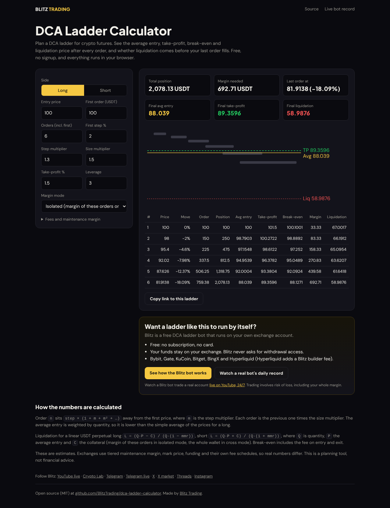

# DCA Ladder Calculator

**[Open the calculator →](https://blitztrading.github.io/dca-ladder-calculator/)**

Also on the Blitz site: [the same calculator with a 2x–20x liquidation reference table](https://www.blitz-trading.com/dca-ladder-calculator?utm_source=github&utm_medium=repo&utm_campaign=gh_dca_calculator&utm_content=readme_site_calculator).

Plan a DCA (dollar-cost averaging) ladder for crypto futures and see, after every order:

- the average entry price (weighted by quantity, not the simple average of prices),
- the take-profit and fee-inclusive break-even price,
- the margin used,
- the liquidation price, for long or short, isolated or cross margin,
- and whether liquidation comes **before** your next order can fill.

Free, no signup, zero dependencies. Everything runs in your browser. Settings live in the URL, so you can share a ladder as a link.

[](https://blitztrading.github.io/dca-ladder-calculator/)

## Inputs

| Input | Meaning |
| --- | --- |
| Side | Long adds below the entry, short adds above it. |
| Entry price | Price of the first order. |
| First order | Position value of the first order, in USDT (not margin). |
| Orders | Total number of orders, including the first. |
| First step % | Distance from the first order to the second. |
| Step multiplier | Each next gap is the previous gap times this. `1` = evenly spaced. |
| Size multiplier | Each next order is the previous order times this. `1` = equal sizes. |
| Take-profit % (price) | Price move from the average entry to the take-profit, not return on margin. Many bots, Blitz included, set TP as return on margin = price move × leverage, so divide a bot's TP by its leverage: a bot TP of 1.5% at 5x is `0.3` here. |
| Leverage | Margin = position value / leverage. |
| Margin mode | Isolated uses the margin of these orders. Cross uses your whole futures wallet. |
| Maintenance margin %, fee % | Defaults `0.5%` and `0.05%` per side. Check your exchange's tiers. |

## How it calculates

Order `n` sits `step × (1 + m + m² + … + mⁿ⁻²)` from the first price, where `m` is the step multiplier.

For a linear (USDT-margined) perpetual with quantity `Q`, average entry `P`, collateral `C` and maintenance margin rate `mmr`:

```
long  liquidation  L = (Q·P − C) / (Q · (1 − mmr))
short liquidation  L = (Q·P + C) / (Q · (1 + mmr))
long  break-even   = P · (1 + fee) / (1 − fee)
short break-even   = P · (1 − fee) / (1 + fee)
```

`C` is the margin of the ladder's filled orders in isolated mode, and the futures wallet in cross mode.

These are estimates. Exchanges use tiered maintenance margin, mark price, funding and their own fee schedules, so real liquidation prices differ. This is a planning tool, not financial advice.

## Use it as a library

`ladder.mjs` has no dependencies and works in Node 18+ and the browser.

```js
import { buildLadder } from './ladder.mjs';

const { rows, summary } = buildLadder({
  side: 'long',
  entryPrice: 100,
  firstOrder: 100,
  orders: 6,
  stepPct: 2,
  stepScale: 1.3,
  sizeScale: 1.5,
  takeProfitPct: 1.5,
  leverage: 3,
  marginMode: 'isolated', // or 'cross' with wallet: 1000
});

console.log(summary.finalAvgEntry, summary.finalLiquidation, summary.liquidatedBeforeOrder);
```

Run the tests with `npm test` (uses the built-in `node:test`, nothing to install).

## Want the ladder to run by itself?

This calculator is made by [Blitz Trading](https://www.blitz-trading.com/dca-trading-bot?utm_source=github&utm_medium=repo&utm_campaign=gh_dca_calculator&utm_content=readme_cta). Blitz is a free DCA ladder bot that runs on your own exchange account:

- **Free.** No subscription and no card. On centralized exchanges the exchange pays Blitz a share of the trading fee, so your fee rate does not go up. Hyperliquid adds a Blitz builder fee, which you see and approve when you connect your wallet.
- **Your funds stay with you.** The bot trades on your own exchange account. Blitz never asks for withdrawal access.
- **Exchanges:** Bybit, Gate, KuCoin, Bitget, BingX and Hyperliquid.
- **See it live.** A real Blitz bot trades on a [24/7 live stream](https://www.youtube.com/@Blitztradinglab/live), and its [daily record](https://github.com/BlitzTrading/live-bot-record) is public, losing days included.

[See how the Blitz bot works →](https://www.blitz-trading.com/dca-trading-bot?utm_source=github&utm_medium=repo&utm_campaign=gh_dca_calculator&utm_content=readme_button)

Trading involves risk of loss, including your whole margin.

## Follow Blitz

- YouTube: [24/7 live bot](https://www.youtube.com/@Blitztradinglab/live) · [Blitz Crypto Lab](https://www.youtube.com/@BlitzCryptoLab)
- Telegram: [Official](https://t.me/Official_Blitz_Trading_bot) · [Live updates](https://t.me/BlitzTradingLive)
- X: [@Blitz_trade_bot](https://x.com/Blitz_trade_bot) · [@Blitz_Market_Up](https://x.com/Blitz_Market_Up)
- Threads: [@blitztradebot](https://www.threads.com/@blitztradebot) · [@blitz_partner](https://www.threads.com/@blitz_partner)
- Instagram: [@blitz_news_26](https://www.instagram.com/blitz_news_26/)

## License

MIT
